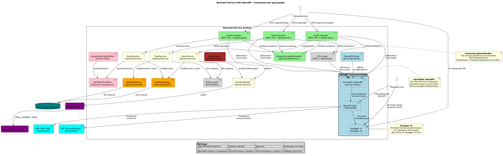
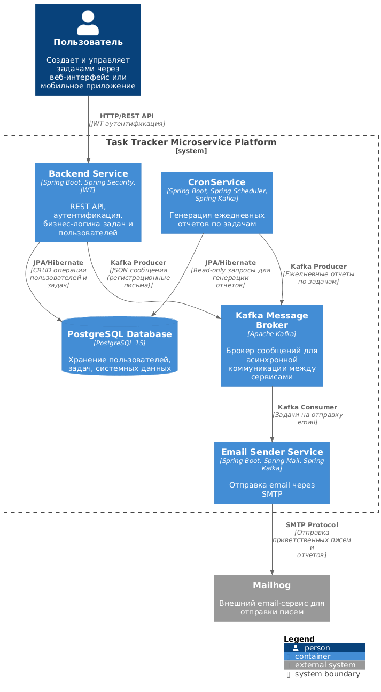

# TASK TRACKER Microservice Platform


## Содержание

- [Архитектура](#архитектура)
- [Диаграммы C4](#диаграммы-c4)
- [Состав репозитория](#состав-репозитория)
- [Стек технологий](#стек-технологий)
- [Предварительные требования](#предварительные-требования)
- [Быстрый старт](#быстрый-старт)
- [Ручной запуск](#ручной-запуск)
- [Docker команды](#docker-команды)
- [Gradle команды](#gradle-команды)
- [Порты и сервисы](#порты-и-сервисы)
- [Debugging / Диагностика](#debugging--диагностика)
- [Конфигурация](#конфигурация)
- [API документация](#api-документация)
- [Postman коллекция](#postman-коллекция)
- [Структура каталогов](#структура-каталогов)

---

## Архитектура

Платформа представляет собой многопользовательский планировщик задач, вдохновленный Trello. 
Пользователи могут использовать его как TODO-лист. Архитектура основана на микросервисах с использованием Spring Boot.

Основные компоненты:
- Backend Service: REST API для регистрации, авторизации (JWT), работы с задачами (создание, редактирование, удаление, пометка как выполненной).
- Scheduler Service: Генерация ежедневных отчетов по задачам (Spring Scheduler запускает задачи по cron в полночь).
- Email Sender Service: Отправка email (приветственные письма при регистрации, ежедневные отчеты) через MailHog с использованием Spring Mail.
- Postgres: хранение пользователей и задач.
- Kafka + Zookeeper: брокер сообщений для асинхронной коммуникации между сервисами (публикация/обработка событий и команд).
- MailHog (dev): локальный SMTP сервер + web UI для просмотра писем во время разработки.
---

## Диаграммы C4

> Исходники диаграмм — в `diagrams/*.puml`. Для удобства в README используются рендеры в PNG.

### Компонентная диаграмма



### Контекстная диаграмма Backend Service



### [Контекстная диаграмма](diagrams/context.puml) 
- Описание взаимодействия системы с внешними пользователями и системами
- Высокоуровневый обзор

> 💡 **Примечание**: Для просмотра диаграмм используйте [PlantUML](https://plantuml.com/) или установите плагин для отображения .puml файлов в вашей IDE.
---

## Состав репозитория

- `backend-service/` — основной backend сервис (Spring Boot REST API).
- `diagrams/` — C4-диаграммы архитектуры (PlantUML).
- `docker-compose.yml` — инфраструктура проекта (PostgreSQL, Kafka, Zookeeper, backend-service).
- `.env.example` — пример переменных окружения.
- `Taskfile.yml` — команды для управления окружением и сборкой проекта.
- `README.md` — документация проекта.

# Стек технологий

- **Java:** 24
- **Framework:** Spring Boot
- **Database:** PostgreSQL
- **Messaging:** Apache Kafka + Zookeeper
- **Containerization:** Docker, Docker Compose
- **Build:** Gradle
- **Migrations:** Liquibase
- **Mapping:** MapStruct
- **API documentation:** OpenAPI (SpringDoc + Swagger UI)
- **Testing:** JUnit

---

# Предварительные требования

Перед запуском проекта убедитесь, что установлены:

- Docker
- Docker Compose
- JDK 24
- Git
---

## Быстрый старт

```bash
# Быстрый запуск полного окружения разработки (Postgres, Kafka, приложение)
task up

# Полный сброс окружения — удаление volumes, пересборка образа и запуск
task reset

# Просмотр логов всех контейнеров Docker Compose в реальном времени
task docker-compose-logs

# Показать список запущенных Docker контейнеров
task status

```

Требуется: Docker, Docker Compose, JDK 24, Task (go-task).

---

## Ручной запуск

```bash
# Запуск всех сервисов напрямую
docker compose -f docker-compose.yml --env-file .env up -d

# Остановка
docker compose -f docker-compose.yml --env-file .env down
```

## Docker команды

```bash
# Сборка Docker образа backend-service
task backend-service-build

# Запуск контейнера backend-service
task backend-service-run

# Остановка контейнера backend-service
task backend-service-stop

# Удаление контейнера backend-service
task backend-service-remove

# Полное удаление контейнера и образа backend-service
task backend-service-clean
```

## Gradle команды
```bash
# Запуск Spring Boot приложения локально
task run

# Сборка проекта и создание jar файла
task build

# Запуск всех тестов
task test

# Очистка папки build
task clean
```

## Порты и сервисы

| Сервис            | Порт (host) | Описание                                     |
|-------------------|-------------|----------------------------------------------|
| Postgres          | 5432        | База данных для пользователей и задач        |
| Zookeeper         | 2181        | Координация для Kafka                        |   
| Kafka             | 9092        | Брокер Kafka                                 | 
| backend-service   | 8081        | REST API Spring Boot приложения              |


---
# Debugging / Диагностика
Проверить контейнеры:
```bash
docker compose ps
```
Просмотреть логи:
```bash
task docker-compose-logs
```
Список контейнеров:
```bash
docker ps
```

# Конфигурация
Все настройки выполняются через переменные окружения.
Скопируйте файл:
```bash
cp .env.example .env
```
### Основные переменные
**Server**
```
SERVER_PORT
```
**PostgreSQL**
```
POSTGRES_DB
POSTGRES_USER
POSTGRES_PASSWORD
```
**Spring Datasource**
```
SPRING_DATASOURCE_URL
SPRING_DATASOURCE_USERNAME
SPRING_DATASOURCE_PASSWORD
```
**Kafka**
```
SPRING_KAFKA_BOOTSTRAP_SERVERS
```
**JWT**
```
JWT_SECRET
```
---

# API документация
Swagger UI доступен по адресу:
```
http://localhost:8081/swagger-ui.html
```
OpenAPI спецификация:
```
http://localhost:8081/v3/api-docs
```
---

# Postman коллекция

Для удобного тестирования API доступна Postman коллекция.

<a href="https://mash77-4007.postman.co/workspace/task-tracker~a5009b8f-ef6f-4bee-9a64-ee045b45e135/collection/41844941-05476f88-28e2-4c97-8619-acaeee2ea940?action=share&source=copy-link&creator=41844941">
  
</a>

После запуска проекта:
```bash
task docker-compose-up
```

API будет доступен:
```
http://localhost:8081
```

## Импорт API в Postman через OpenAPI
1. Запустите проект
```bash
task docker-compose-up
```
2. Откройте Postman
3. Нажмите **Import → Link**
4. Вставьте:
```
http://localhost:8081/v3/api-docs
```
Postman автоматически создаст коллекцию со всеми endpoints.
---

## Структура каталогов
```
.
├── backend-service/
│   ├── build.gradle
│   ├── gradle.properties
│   ├── settings.gradle
│   ├── openapi/
│   │   ├── service-api.yml
│   │   ├── task-api.yml
│   │   └── user-api.yml
│   ├── gradle/
│   │   └── wrapper/
│   │       ├── gradle-wrapper.jar
│   │       └── gradle-wrapper.properties
│   ├── gradlew
│   ├── gradlew.bat
│   └── src/
│       ├── main/
│       │   ├── java/
│       │   └── resources/
│       └── test/
│           ├── java/
│           └── resources/
├── diagrams/
│   ├── BackendServiceComponentDiagramWithOpenAPI.png
│   ├── component.puml
│   ├── context.png
│   └── TaskTrackerArchitecture.puml
├── gradle/
│   └── wrapper/
│       ├── gradle-wrapper.jar
│       └── gradle-wrapper.properties
├── .dockerignore
├── .env.example
├── .gitignore
├── button.svg
├── docker-compose.yml
├── Dockerfile
├── gradlew
├── gradlew.bat
├── settings.gradle
├── Taskfile.yml
└── README.md
```
